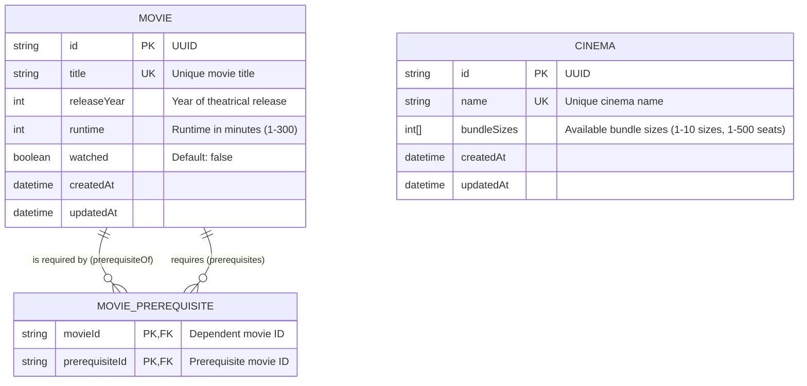
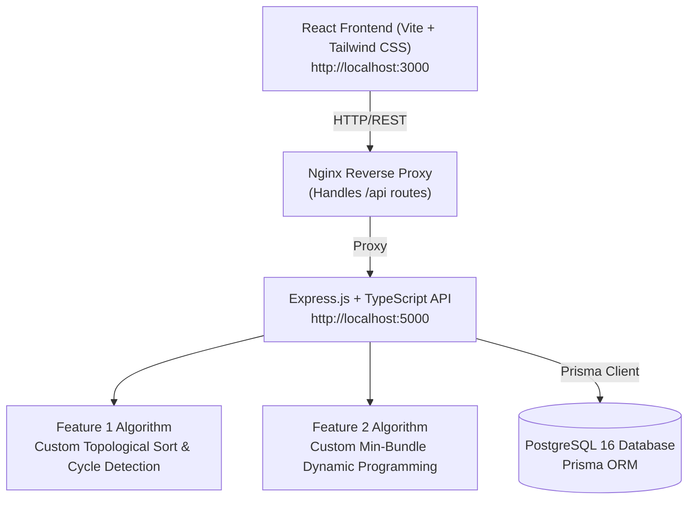

# Doomsday Ready 🎬🍿

[](file:///E:/Doomsday)
[](https://nodejs.org/)
[](https://www.typescriptlang.org/)
[](https://www.postgresql.org/)
[](https://www.prisma.io/)
[](https://react.dev/)
[](https://www.docker.com/)

> **Blinto Talent Accelerator 2027 — Full-Stack Developer Internship Assessment**  
> A full-stack web application designed for Marvel Cinematic Universe (MCU) fans to plan their rewatch ahead of *Avengers: Doomsday* and optimize opening-night watch-party seat bundles.

---

## 🔗 Live Application & Access Links

| Environment | Access Link | Description |
|---|---|---|
| 🌐 **Live Cloud Demo (Render)** | **[https://doomsday-frontend.onrender.com](https://doomsday-frontend.onrender.com)** | **Hosted 24/7 online.** Anyone can open this link directly in their browser or mobile device with zero setup. |
| 💻 **Local Docker (Frontend)** | **[http://localhost:5173](http://localhost:5173)** or **[http://127.0.0.1:5173](http://127.0.0.1:5173)** | Accessible on your computer after running `docker compose up`. |
| 🔌 **Local Docker (Backend API)** | **[http://localhost:5000/api](http://localhost:5000/api)** | REST API endpoints for movies, rewatch ordering, and cinemas. |
| 🩺 **Backend Healthcheck** | **[http://localhost:5000/health](http://localhost:5000/health)** | Instant API health verification (`{"status":"ok"}`). |

---

## 📑 Table of Contents
- [Project Overview](#-project-overview)
- [Rules & AI Disclosure](#-rules--ai-disclosure)
- [Data Model & Architecture (Bonus)](#-data-model--architecture-bonus)
- [Custom Core Algorithms](#-custom-core-algorithms)
  - [1. Cycle Detection & Rewatch Order (Feature 1)](#1-cycle-detection--rewatch-order-feature-1)
  - [2. Minimum Seat Bundle Optimizer (Feature 2)](#2-minimum-seat-bundle-optimizer-feature-2)
- [API Reference](#-api-reference)
- [Frontend Views (Feature 3)](#-frontend-views-feature-3)
- [Quick Start Guide](#-quick-start-guide)
  - [Option A: One-Command Start via Docker Compose (Bonus)](#option-a-one-command-start-via-docker-compose-bonus)
  - [Option B: Local Development Setup](#option-b-local-development-setup)
- [Running Automated Tests](#-running-automated-tests)
- [Design Decisions & Assumptions](#-design-decisions--assumptions)

---

## 🌟 Project Overview

MCU movies frequently build on previous installments, creating a complex dependency graph. As *Avengers: Doomsday* approaches, fans need an exact roadmap of which movies to rewatch and in what order. Simultaneously, cinemas sell opening-night tickets only in fixed bundle sizes (e.g., bundles of 2, 5, or 6, 9, 20 seats). Fans need to determine the fewest bundles to purchase so that everyone in their group gets a seat without paying for empty chairs.

### What was built:
1. **Feature 1: Movies & Rewatch Order**
   - CRUD operations for movies with runtime (1–300 mins), release year, and watch status.
   - Self-dependency and transitive circular dependency prevention returning HTTP `409 CIRCULAR_DEPENDENCY`.
   - Custom topological sort computing the exact prerequisite watch order, watched count, and unwatched runtime in minutes.
2. **Feature 2: Cinemas & Watch-Party Booking**
   - CRUD operations for cinemas with customizable opening-night seat bundle sizes (1–10 bundles, 1–500 seats each).
   - Custom minimum coin-change (unbounded knapsack) dynamic programming algorithm returning the optimal bundle breakdown or `"Not possible"` if no exact match exists.
3. **Feature 3: React Frontend**
   - Three dedicated interactive views: *Movies*, *Rewatch Plan*, and *Watch-Party Booking*.
4. **DevOps & Bonuses**:
   - Single-command startup with Docker Compose (`docker compose up`).
   - PostgreSQL 16 database with Prisma ORM.
   - Comprehensive test suite covering all cases from the challenge specification.

---

## 🤖 Rules & AI Disclosure

As required by the assessment guidelines:
1. **Rule Compliance**: The logic for **Feature 1 (Cycle Detection & Topological Sort)** and **Feature 2 (Unbounded Knapsack / Minimum Bundle Solver)** was authored entirely from scratch without using third-party graph solvers, topological sort libraries, or knapsack/linear programming packages.
2. **AI Tool Transparency**:
   - **Tool Used**: Google Antigravity / Gemini assistant.
   - **How it was used**: Assisted in project structure scaffolding, drafting TypeScript types, generating Tailwind styling components, setting up multi-stage Dockerfiles, and reviewing edge case unit tests.
   - **Verification**: Every algorithmic routine, database transaction, and API endpoint was verified against the challenge specification test cases.

---

## 📐 Data Model & Architecture (Bonus)

### Entity-Relationship Diagram (ERD)



### System Architecture



---

## 🧠 Custom Core Algorithms

### 1. Cycle Detection & Rewatch Order (Feature 1)
Located in [`backend/src/algorithms/rewatchOrder.ts`](backend/src/algorithms/rewatchOrder.ts).

* **Circular Dependency Detection**:
  - When creating or updating a movie's prerequisites:
    1. Checks for immediate self-dependencies (`movieId === prereqId`).
    2. Performs directed graph reachability via BFS from each proposed prerequisite to detect transitive cycles back to `movieId`.
    3. Runs a three-color depth-first search (`0: unvisited`, `1: visiting`, `2: visited`) across the temporary proposed graph to ensure no back-edges exist.
    4. Rejects any violation with HTTP `409 CIRCULAR_DEPENDENCY`.
* **Topological Rewatch Order**:
  - Given target movie `T`:
    1. Transitive traversal via BFS collects all prerequisite dependencies, excluding `T`.
    2. Constructs the prerequisite subgraph and computes in-degrees for each movie within the subgraph (where in-degree represents unmet prerequisites in the watch order).
    3. Executes **Kahn's Algorithm** with a priority queue (sorted by release year and title for deterministic chronological order) to yield the exact sequence where every movie appears strictly after all its prerequisites.
    4. Calculates total watched movies and remaining unwatched runtime in minutes.

### 2. Minimum Seat Bundle Optimizer (Feature 2)
Located in [`backend/src/algorithms/bookingQuote.ts`](backend/src/algorithms/bookingQuote.ts).

* **Unbounded Knapsack / Minimum Coin Change DP**:
  - Given cinema bundle sizes $S = \{s_1, s_2, \dots, s_k\}$ and group size $N \in [1, 10000]$:
    - Maintains `dp[w]` representing the minimum number of bundles needed for exact seat count $w$.
    - Maintains `parent[w]` recording which bundle size produced the optimal transition.
    - Transitions: $dp[w] = \min_{s \in S} (dp[w - s] + 1)$.
    - Time Complexity: $O(N \cdot |S|) \le 10,000 \times 10 = 100,000$ operations (executes in $< 2$ milliseconds).
    - If `dp[N] == INF`, returns `{ possible: false, formatted: "Not possible" }`.
    - Otherwise, backtracks through `parent` to reconstruct the exact count of each bundle size in descending order (e.g., `4 bundles: 20 × 1, 9 × 2, 6 × 1`).

---

## 🔌 API Reference

Base URL: `http://localhost:5000/api`

| Method | Endpoint | Description |
|---|---|---|
| `POST` | `/api/movies` | Create a movie (`title`, `releaseYear`, `runtime`, `prerequisites`, `watched`) |
| `GET` | `/api/movies` | List all movies with their prerequisite relationships |
| `PATCH` | `/api/movies/:id` | Update movie attributes, toggle watched, or edit prerequisites |
| `GET` | `/api/movies/:id/rewatch-order` | Compute ordered rewatch list, watched count, and unwatched runtime |
| `POST` | `/api/cinemas` | Create a cinema (`name`, `bundleSizes`) |
| `GET` | `/api/cinemas` | List all available cinemas |
| `GET` | `/api/cinemas/:id/booking?groupSize=N` | Calculate minimum bundle booking quote |

### Example Responses

#### Rewatch Order (`GET /api/movies/:id/rewatch-order`):
```json
{
  "targetMovie": {
    "id": "e4b2d...",
    "title": "Avengers: Doomsday",
    "releaseYear": 2026,
    "runtime": 180,
    "watched": false
  },
  "movies": [
    { "id": "1", "title": "Iron Man", "releaseYear": 2008, "runtime": 126, "watched": true },
    { "id": "2", "title": "Captain America: The First Avenger", "releaseYear": 2011, "runtime": 124, "watched": true },
    { "id": "3", "title": "The Avengers", "releaseYear": 2012, "runtime": 143, "watched": true },
    { "id": "4", "title": "Captain America: Civil War", "releaseYear": 2016, "runtime": 147, "watched": false },
    { "id": "5", "title": "Thor: Ragnarok", "releaseYear": 2017, "runtime": 130, "watched": false },
    { "id": "6", "title": "Avengers: Infinity War", "releaseYear": 2018, "runtime": 149, "watched": false },
    { "id": "7", "title": "Avengers: Endgame", "releaseYear": 2019, "runtime": 181, "watched": false }
  ],
  "watchedCount": 3,
  "unwatchedRuntime": 607
}
```

#### Booking Quote (`GET /api/cinemas/:id/booking?groupSize=44`):
```json
{
  "cinemaId": "c1...",
  "cinemaName": "Avengers Campus Theater",
  "possible": true,
  "groupSize": 44,
  "totalBundles": 4,
  "bundles": [
    { "size": 20, "count": 1 },
    { "size": 9, "count": 2 },
    { "size": 6, "count": 1 }
  ],
  "formatted": "4 bundles: 20 × 1, 9 × 2, 6 × 1"
}
```

---

## 💻 Frontend Views (Feature 3)

1. **Movies View**:
   - Browse the full catalog of MCU films.
   - Interactive watched checkboxes with instant optimistic updates.
   - Modal to add new movies and edit existing prerequisites with real-time cycle detection warnings.
2. **Rewatch Plan View**:
   - Select any target movie (defaults to *Avengers: Doomsday*).
   - Summary stat cards displaying prerequisite count, watched count, and remaining unwatched runtime in hours and minutes.
   - Animated visual progress bar (e.g. `4 of 7 watched (57%)`).
   - Chronological and topologically ordered list of movies with step badges (`#1`, `#2`, `#3`...).
3. **Watch-Party Booking View**:
   - Pick a cinema and enter any party size from 1 to 10,000.
   - One-click presets for sample test cases (6, 11, 44, 7, etc.).
   - Visual breakdown cards showing bundle counts and verification of exact seat counts.

---

## 🚀 Quick Start Guide

### Option A: One-Command Start via Docker Compose (Bonus)

Ensure Docker Desktop is running on your machine, then run:

```bash
docker compose up --build
```

This single command will:
1. Spin up a **PostgreSQL 16** database container with health checks.
2. Build and start the **Express backend API** on port `5000` (automatically runs database migrations and seeds initial MCU movies and cinemas).
3. Build and serve the **React frontend** via Nginx on port `5173`.

#### 💻 How to Open in Your Browser (Local Machine):
Once the command finishes starting the containers, copy and paste either of these links into your web browser:
* 👉 **[http://localhost:5173](http://localhost:5173)**
* 👉 **[http://127.0.0.1:5173](http://127.0.0.1:5173)**

*(Alternatively, in the **Docker Desktop** application under the "Containers" list, click the blue **`5173:80`** port link next to `doomsday_frontend` to launch it immediately).*

To stop all local containers:
```bash
docker compose down
```

---

### Option B: Local Development Setup

#### 1. Prerequisites
- Node.js v20+
- PostgreSQL running locally on port 5432

#### 2. Backend Setup
```bash
cd backend
npm install

# Configure your environment variables in .env
cp .env.example .env

# Run Prisma migrations and seed the sample MCU data
npx prisma db push
npx tsx prisma/seed.ts

# Start backend dev server
npm run dev
```
Backend will be live at `http://localhost:5000`.

#### 3. Frontend Setup
```bash
cd frontend
npm install

# Start Vite dev server
npm run dev
```
Frontend will be live at `http://localhost:5173`.

---

## 🧪 Running Automated Tests

A comprehensive test suite is included in `backend/src/tests/` using Vitest and Supertest:
- `rewatchOrder.test.ts`: Validates self-dependency prevention, transitive cycle detection (`409 CIRCULAR_DEPENDENCY`), and topological watch ordering across all sample cases.
- `bookingQuote.test.ts`: Validates the minimum bundle knapsack solver across all sample bundle combinations (`[1, 3, 4] -> 6`, `[2, 5] -> 11`, `[6, 9, 20] -> 44`, `[4, 6] -> 7 (Not possible)`), plus large group sizes up to 10,000.
- `api.test.ts`: Integration contract tests for all REST endpoints.

To run the tests:
```bash
cd backend
npm test
```

---

## 📝 Design Decisions & Assumptions
1. **Target Movie Exclusion**: Per the specification ("*Do not include the target itself*"), the rewatch order only returns movies you must watch *before* the target premiere.
2. **Deterministic Topological Sort**: When multiple prerequisite movies are concurrently unblocked (e.g., *Iron Man* and *Captain America: The First Avenger*), they are sorted chronologically by `releaseYear` to provide the most natural viewing experience.
3. **Database Choice**: PostgreSQL was selected with an explicit `MoviePrerequisite` join table to model the many-to-many self-referencing relationship cleanly with cascading deletes.
4. **Bundle Solvability**: The unbounded knapsack dynamic programming algorithm operates in $O(N \cdot k)$ time, easily handling the maximum group size of 10,000 in under 2 milliseconds without greedy heuristics.
